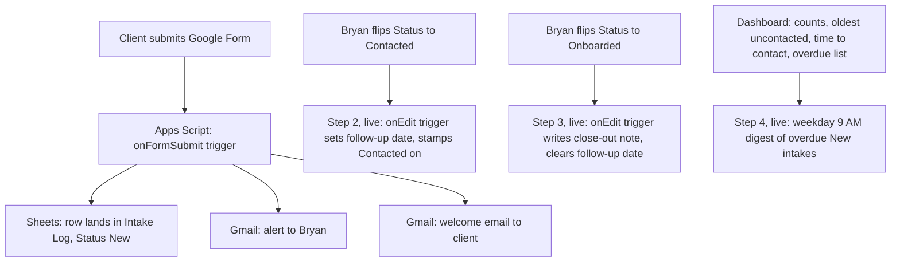

# 🚀 Client Onboarding Workflow - Intake Pipeline

A client inquiry walks in through a Google Form and walks out as tracked onboarding work. No inbox archaeology. No "wait, did anyone reply to them?" Just a pipeline that keeps its own promises.

**Status:** All four steps are live and verified end to end (Nov 24, 2026). A form submit lands a row in the log, fires both emails, and the Dashboard moves. Step 2 stamps the follow-up date and Contacted on. Step 3 writes the close-out note. Step 4 sends the weekday 9 AM overdue digest. The 729-line patched build was installed Nov 24, 2026, with the stabilization patch (formula-injection sanitize, ET timestamp, handler lock, and more).

**Plot twist:** this plan started life as Zapier (Nov 18, 2026) and jumped ship to Google Apps Script on Nov 24, 2026, at Bryan's direction. And no, this is not the lead-tracking Zap. That one is a different flow, it is paused, and it has nothing to do with client onboarding.

## 😱 The Problem

A new client inquiry shows up as an email, then lives in an inbox. No record of what they asked for. No promise kept in view. No way to see which inquiries are still waiting. Work gets dropped quietly, and nobody notices until it is too late.

## 🧠 Why This Shape

This is a business pipeline, not another personal tracker. Intake, triage, onboarding, with real lifecycle stages and a client-facing promise: a reply within one business day. The status column is the spine. It drives behavior instead of sitting there as a label.

## 🏗️ Architecture

## 🛠️ Pipeline Stages

### 1. Intake - Google Form ✅ Live

Five questions. "What they need" is a service catalog, not a free-text box: Automation build, RevOps setup, Workflow audit, Other. The form description states the promise: a reply within one business day. The Form is personal-owned (frncsbryn54@gmail.com), live, and verified Nov 24.

| Form field | Required | Notes |
|---|---|---|
| Name | Yes | Short answer |
| Company | No | Short answer |
| Email | Yes | Short answer; no built-in email validation in the Forms API, so the field carries "Please double-check your email address" as helper text |
| What they need | Yes | Multiple choice: Automation build, RevOps setup, Workflow audit, Other |
| Start date | No | Date question, year included, no time |

### 2. Logging + Emails - Step 1 - Intake ✅ Live

The script is bound to the Form, trigger `onFormSubmit` (function `onIntakeSubmit`), running as frncsbryn54@gmail.com. On submit it does three things, fast:

1. Writes the row at the first empty row of the Intake Log. Status is stamped `New`. Follow-up date, Contacted on, and Notes / Close-out start blank. The SLA flag is a per-row formula written by the script at append time (see Live fixes); a column-wide ARRAYFORMULA is never used in K.
2. Gmail alert to Bryan (Bfrancis360AI@gmail.com), from personal: new intake, all fields, link to the Sheet.
3. Gmail welcome email to the client, from personal: thanks them, names what they asked for, repeats the one-business-day reply promise.

Local source: `apps-script/Code.gs` — this is the source to install from. Live now runs the 729-line patched build (installed Nov 24, 2026), matching this file.

### 3. Status-Driven Behavior - Step 2 - Contacted, Step 3 - Onboarded

Status is a lifecycle: New → Contacted → Onboarded. Each step has its own installable onEdit trigger on the Sheet (`onStatusChange` for Step 2, `onOnboarded` for Step 3); both watch the Status column.

**Step 2 - Contacted sets a follow-up date. ✅ Live.** Condition: Status is `Contacted` and Contacted on is empty. Action: stamp Contacted on as today and set Follow-up date 2 business days out (leaving a hand-entered Follow-up date alone). The loop guard is the column-G check: the handler only acts when the edited range includes Status, so its own writes never re-trigger it. The Contacted-on condition is the idempotency guard.

**Step 3 - Onboarded closes out cleanly. ✅ Live.** Condition: Status is `Onboarded` and Notes / Close-out does not already carry the machine close-out note. Action: write (or append) `Onboarded [date] — welcome complete; no further follow-up.` into Notes / Close-out and clear Follow-up date. A hand-written note does not block the close-out.

### 4. SLA Flag + Digest - Dashboard + Step 4 - Overdue Digest

Any New intake sitting longer than one business day gets flagged, so the one-business-day promise is enforced by the system, not just stated in the welcome email.

- The Intake Log has an `SLA flag` column: `OVERDUE` appears on any row that is still New more than one business day after its timestamp. The script writes a per-row formula in K at append time.
- The Dashboard lists every overdue New intake with its timestamp, name, company, email, what they need, and start date.
- Step 4 (✅ live): time-driven trigger, weekdays 9:00 AM ET, reads the log, keeps only the overdue New rows, and emails Bryan a digest only if at least one exists.

### 5. Reporting - Dashboard ✅ Live, Verified

The Dashboard tab on the Sheet computes everything from the Intake Log:

| Figure | How it is computed |
|---|---|
| Count by status | COUNTIF on the Status column (New / Contacted / Onboarded / Total) |
| Oldest uncontacted intake | Earliest timestamp where Status is New, with the name and business days waiting |
| Time to contact | Average and median whole days from intake timestamp to Contacted on, for rows currently Contacted |
| Overdue New intakes | FILTER of New rows whose timestamp is more than one business day old |

## 📊 The Sheet

- **Intake Log:** https://docs.google.com/spreadsheets/d/1Bl4Of8_4h9detzvHw5gfcTpEYCoraryBpJuIkHGZm-Y/edit
- Columns: Timestamp, Name, Company, Email, What they need, Start date, Status, Follow-up date, Contacted on, Notes / Close-out, SLA flag.
- Status and What they need are dropdown-validated to the catalog values. The Sheet is BUSINESS-owned (Bfrancis360AI@gmail.com) and shared to the personal account (frncsbryn54@gmail.com) as Editor; the script writes to it through that share. Do not claim the Sheet lives in personal.

## 📍 Status

| Piece | State |
|---|---|
| Google Sheet (Intake Log + Dashboard) | Live and verified (see Runbook, Test evidence) |
| Google Form | Live and verified Nov 24, 2026 |
| Step 1 - Intake (log + emails) | Live and verified Nov 24, 2026 - row lands, both emails go out, Dashboard updates |
| Step 2 - Contacted (follow-up date, Contacted on) | Live Nov 24, 2026; stabilization patch installed 8:58 PM |
| Step 3 - Onboarded (close-out note) | Live Nov 24, 2026 |
| Step 4 - Overdue digest (weekday 9 AM) | Live Nov 24, 2026 |

## 🩹 Live Fixes (Nov 24, 2026)

Real bugs, caught live, fixed the same day:

- **The case of the empty `namedValues`.** The first live trigger run arrived with `e.namedValues` empty: the Sheet row landed with timestamp + Status New and every other field blank, the alert went out with all fields blank, and the welcome email never sent (no recipient). The script now falls back to `e.response.getItemResponses()` for any missing title, with `responseValueString` normalizing date answers to `yyyy-mm-dd`. Verified on the second live run: full row, full alert, welcome sent.
- **The rows that ran away to 999.** A column-wide ARRAYFORMULA in K breaks appends: it extends the data range, so new rows landed at rows 999–1000 and the log looked empty at the top. The ARRAYFORMULA was cleared and Step 1 now writes a per-row formula in K at append time. Never use a column-wide ARRAYFORMULA in K again.

## 📦 Sample Payload

See `sample-payloads/intake.json` for an anonymized example of one intake as Step 1 writes it to the log. The sample matches the log schema exactly (plus a `note` metadata field).

## 📖 Runbook

See `docs/runbook.md` for deployment, the exact Form and script specs, maintenance, and troubleshooting notes.

## 🖥️ Demo Portal

`app/` is a fictional-data-only demo of the same pipeline (see `spec.md` for the frozen acceptance checks). It is not connected to the live Sheet or Form; its form and status controls only change fictional data in the browser. Use it to walk through the pipeline in a Loom or a demo, not as a working intake.

## 🔒 Privacy Note

This repository contains **mock data only**. No real names, emails, phone numbers, or client details are included. The sample payload uses clearly synthetic values. Test rows used Bryan's own business email and were deleted after verification, except the Darius row Bryan asked to keep.

## 🤝 Honest Framing

This is an AI-assisted build. Bryan directed the design and the Apps Script; he did not hand-write code. The script uses AI-generated JavaScript that he directed and tested. Nothing here claims hand-written code.

## 💪 Skills Demonstrated

- Business process design (intake pipeline with a lifecycle, not just a form)
- Google Apps Script automation (Form trigger, Sheet writes, Gmail sends, per-row formulas)
- Google Forms as an intake layer with a defined service catalog
- Google Sheets as a logging layer plus a live reporting dashboard
- Status-driven automation (follow-up dates, close-outs, SLA enforcement)
- Technical documentation and runbook authoring
